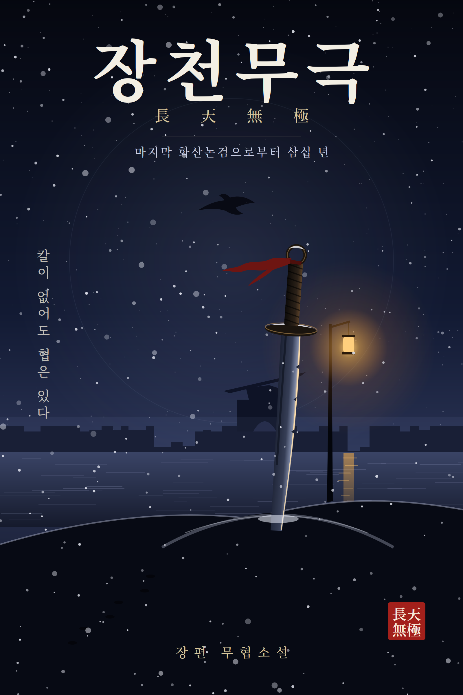

# 장천무극(長天無極)

> 장편 무협소설 · 마지막 화산논검으로부터 삼십 년

양양성이 무너진 지 열여섯 해. 몽골 무장의 아들이자 양양 여협의 아들인 열여덟 살 소백(蕭白)은, 사부의 죽음과 함께 "곽정의 칼, 도룡도가 다시 세상에 나왔다"는 소문의 한가운데로 떨어진다. 어느 편에도 온전히 속하지 못한 소년이 칼이 아닌 자기 손으로 천하제일에 오르는 이야기.

## 목차

- [제1장 雪夜殘燈 — 눈 내리는 밤, 꺼지지 않는 등불](chapters/01.md)
- [제2장 仁義之莊 — 인의(仁義)라는 이름의 장원](chapters/02.md)
- [제3장 峨嵋雲深 — 아미산 구름 깊은 곳](chapters/03.md)
- [제4장 聖火西來 — 성화는 서쪽에서 오고](chapters/04.md)
- [제5장 大都風雲 — 대도의 바람과 구름](chapters/05.md)
- [제6장 武當論圓 — 무당산에서 원(圓)을 논하다](chapters/06.md)
- [제7장 寶刀誅心 — 보도(寶刀)는 마음을 벤다](chapters/07.md)
- [제8장 古墓長天 — 고묘 위의 긴 하늘](chapters/08.md)
- [제9장 江南血月 — 강남의 붉은 달](chapters/09.md)
- [제10장 華山論劍 — 화산에서 검을 논하다](chapters/10.md)

---

전 10장 · 약 35만 자
