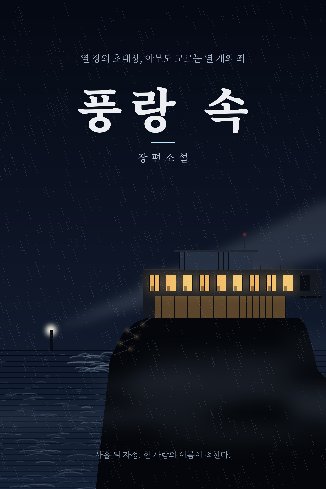

# 풍랑 속

> 장편 미스터리 서스펜스 · 2040년 늦가을, 통영 앞바다의 외딴섬

풍랑주의보가 태풍 경보로 치닫는 밤, 사유섬 은도(隱島)의 저택에 저마다 다른 미끼에 이끌린 열 명이 모인다. 모두 아무도 모르는 죄를 지은 사람들이다. 죽은 AI 재벌 도건우가 남긴 영상이 규칙을 알린다. "사흘 뒤 자정, 여러분이 지목한 한 사람이 사형됩니다. 그리고 여러분 중 한 명은 사람이 아닙니다." 흉부외과 교수 차은수는 사람들 틈에 숨은 기계를 찾아 나서지만, 섬에 갇힌 사흘 동안 게임의 규칙과 질문은 정반대로 뒤집힌다.

## 목차

- [제1장 초대(招待) — 열 번째 손님](chapters/01.md)
- [제2장 면담(面談) — 사람을 가려내는 질문](chapters/02.md)
- [제3장 희생(犧牲) — 탁자 밑의 폭탄](chapters/03.md)
- [제4장 원문(原文) — 묻지 않은 질문](chapters/04.md)
- [제5장 상속(相續) — 지하의 여자](chapters/05.md)
- [제6장 판결(判決) — 열 개의 이름](chapters/06.md)

---

전 6장 · 약 14.6만 자
